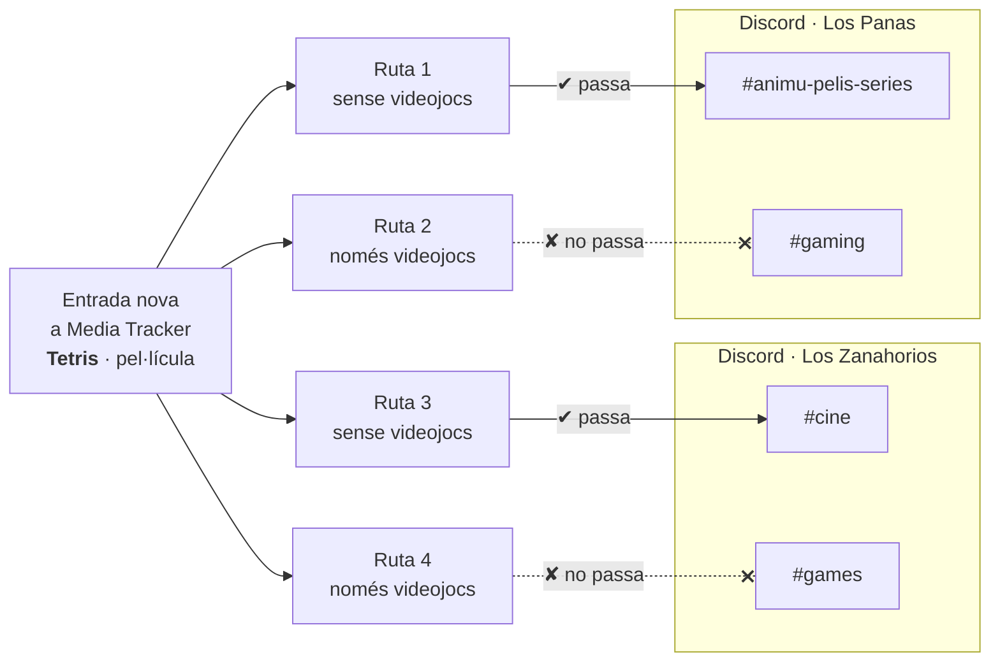
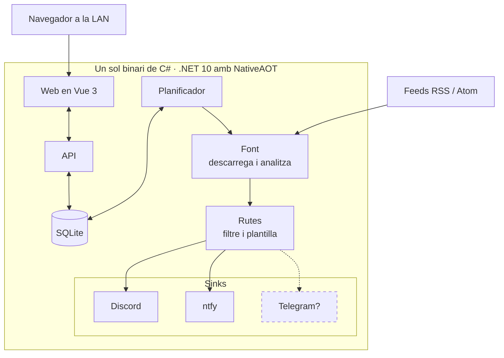

Hola una altra vegada!

Tinc un parell de servidors de Discord on un bot avisa de les entrades noves de blogs, vídeos de YouTube, newsletters i de les llistes d'anime i manga dels meus amics. Durant anys això ho va fer MonitoRSS. Funciona, però són nou contenidors (diversos serveis en Node, Mongo, Postgres, RabbitMQ...) i uns 670 MB de RAM per mirar cada deu minuts si hi ha alguna cosa nova en uns quants feeds. En un servidor casolà que ja té Jellyfin i mitja dotzena de coses més, em semblava una barbaritat, i com sabeu, el món no està per regalar RAM. Així que me'n vaig fer un de propi.

## Què és
InformadoRSS és un servei autoallotjat que mira feeds RSS i Atom, filtra els elements i els envia a canals de Discord. Un contenidor, un fitxer SQLite i una web que serveix el mateix binari. És de codi obert (MIT):



La idea és senzilla:

- Un **feed** és una URL.
- Una **ruta** diu què fer amb un feed: un filtre, una o diverses destinacions (un canal de Discord o ntfy) i una plantilla de missatge.
- La web té un constructor de filtres, un editor de plantilles i un selector de servidors i canals, per no haver de copiar ids a mà.
- El bot parla amb Discord només per l'API REST. Res de gateway, ni comandes, ni webhooks. Així de senzill.
- Quan un feed o una destinació es trenca m'envia un únic missatge privat per Discord, i un altre quan es recupera.

Per exemple, el feed de Media Tracker, on surt el que acabo de veure o de jugar, té quatre rutes: a cada servidor les pel·lícules i sèries van a un canal i els videojocs a un altre. Quan acabo Tetris, l'entrada passa per les quatre i només arriba als canals que l'accepten:

## L'stack
C# amb .NET 10 compilat amb NativeAOT, i un frontend en Vue 3 que acaba com a fitxers estàtics dins del mateix binari. Vaig triar C# perquè és el que faig servir cada dia, i per això vaig descartar Go i C++. Tenia curiositat per provar de fer alguna cosa d'aquest estil amb un d'aquests llenguatges, però al final C# és amb el que em sento més còmode llegint. L'emmagatzematge és SQLite, amb una còpia de seguretat diària a un altre disc, tot i que no seria una gran pèrdua.

Així es veu per dins:

La idea és que tot sigui modular. Cada destinació és un sink, una classe que implementa una interfície molt petita: un nom i un mètode que lliura el missatge. Ara mateix n'hi ha dos, Discord i ntfy, i afegir-ne un altre, com Telegram, és escriure aquesta classe i registrar-la, sense tocar el planificador ni els filtres; la web el detecta sola i ja l'ofereix com a destinació. Amb les fonts passa el mateix: avui només hi ha RSS i Atom, però estan darrere de la seva pròpia interfície.

## Els números
Posem els números sobre la taula i comparem els dos serveis en moments semblants: en repòs, amb els mateixos feeds i mirant cada deu minuts. MonitoRSS ja l'he apagat per raons òbvies, així que les seves xifres són d'abans del canvi.

| | InformadoRSS | MonitoRSS |
| --- | --- | --- |
| Contenidors | 1 | 9 |
| RAM | 75 MiB | uns 670 MB |
| Imatge | 37 MB | uns 3,9 GB sumades |
| Dades en disc | 4,5 MB | 656 MB |

Tot i que els números són molt bons, encara hi ha marge de millora. En el primer experiment, sense feeds ni web, el binari AOT gastava uns 10 MiB, i en producció són 75 MiB: el recol·lector d'escombraries de .NET no té cap pressa per tornar memòria en una màquina amb 15 GB lliures. Si algun dia m'importa, li puc limitar el heap. També escriu uns 50 MB al dia en disc, gairebé tot logs massa detallats del client HTTP, que s'arreglen abaixant el nivell de log.

## Fet amb Claude
Primer vaig escriure el disseny en una nota d'Obsidian (què fa MonitoRSS, què faig servir jo de debò i què puc llençar) i després el vaig partir en tasques. Claude en va executar diverses en paral·lel en worktrees de git diferents, cadascuna amb la seva pull request, i jo les revisava i les fusionava per onades: emmagatzematge, filtres i parser de feeds, després el planificador i l'enviament a Discord, i finalment l'importador, les alertes, les còpies de seguretat i la web. Crec que he trobat una manera de treballar molt còmoda amb la IA, potser aviat escric un post de com treballo.

## El canvi
El que feia por no era el codi, era el canvi de l'un a l'altre. Vaig fer un importador que llegeix un `mongoexport` de MonitoRSS i crea els feeds i les rutes. La primera passada enviava totes les destinacions a un canal de proves i enviava l'últim element de cada feed, per comparar els missatges l'un al costat de l'altre. Quan va quadrar, vaig aturar els contenidors de MonitoRSS, vaig apuntar les 22 rutes als canals de veritat i les vaig marcar com a vistes en silenci perquè ningú es mengés una allau d'entrades velles. Si alguna cosa sortia malament, un `docker start` i torna l'stack antic. La veritat és que va sortir gairebé perfecte a la primera.

## Coses que em van donar guerra
- **Els feeds de YouTube retornen 404 unes hores cada matí.** És una caiguda global, no la meva IP. Per això un feed només es considera trencat després de sis hores seguides fallant. No entenc gaire per què li passa això a YouTube. [Sembla un error de fa temps](https://www.reddit.com/r/youtube/comments/1r61jpo/all_youtube_channel_rss_feeds_are_down_return_404/).
- **MyAnimeList reescriu les entrades al mateix lloc.** El guid de cada entrada és la URL de l'anime i l'estat viu a la descripció, així que passar de `Watching` a `Completed` no s'enviava mai. A MonitoRSS passava igual. Ara un feed pot tenir un patró d'identitat, una expressió regular sobre la descripció que s'afegeix a l'id de l'element, i cada estat compta com un element nou. Igualment és una merda com MAL organitza l'RSS (Ori, no t'ho dic més, posa RSS a la teva app de tracking).
- **Elements vells després d'una caiguda.** Els elements més antics que un màxim es marquen com a vistos sense enviar-se, i des de la web se'n pot enviar o reiniciar qualsevol a mà. Això em sol passar perquè trigo diversos dies a escriure un post: m'oblido d'actualitzar la data, apareix com a publicat fa uns quants dies i es perd l'enviament.

## El que falta
És un servei molt bàsic, té just el que necessito. MonitoRSS té molta més personalització i pots fer més coses, però no ho necessito, i menys a canvi de gastar nou vegades més RAM.

Falten coses com els missatges de Discord amb Components V2, una previsualització del missatge a l'estil de Discord i un filtre de Shorts per a YouTube. No té login: està pensat per a una LAN de confiança.

Ho tinc muntat força modular, així que puc afegir altres fonts o altres sinks, i si necessito alguna funcionalitat la puc afegir fàcilment: no és un servei gaire complex. De moment ho deixaré així, obert per a qui el vulgui fer servir o millorar.

Si fas servir MonitoRSS i vols alguna cosa més lleugera, prova'l i fes-hi una ullada.

Ens veiem al següent!
