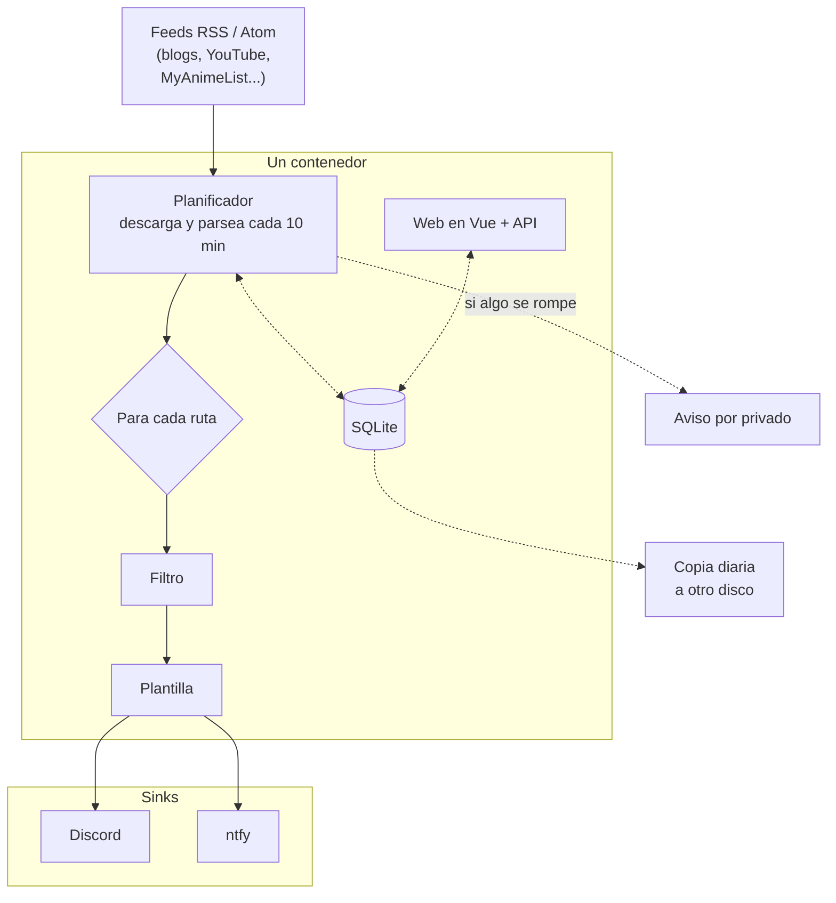

¡Hola otra vez!

Tengo un par de servidores de Discord donde un bot avisa de las entradas nuevas de blogs, vídeos de YouTube, newsletters y de las listas de anime y manga de mis amigos. Durante años eso lo hizo MonitoRSS. Funciona, pero son nueve contenedores (varios servicios en Node, Mongo, Postgres, RabbitMQ...) y unos 670 MB de RAM para mirar cada diez minutos si hay algo nuevo en unos feeds. En un servidor casero que ya tiene Jellyfin y media docena de cosas más, me parecía una barbaridad, y como sabéis, el mundo no está para regalar RAM. Así que me hice el mío.

## Qué es
InformadoRSS es un servicio autoalojado que mira feeds RSS y Atom, filtra los elementos y los manda a canales de Discord. Un contenedor, un archivo SQLite y una web que sirve el mismo binario. Es de código abierto (MIT):



La idea es sencilla:

- Un **feed** es una URL.
- Una **ruta** dice qué hacer con un feed: un filtro, uno o varios destinos (un canal de Discord o ntfy) y una plantilla de mensaje.
- La web tiene un constructor de filtros, un editor de plantillas y un selector de servidores y canales, para no tener que copiar ids a mano.
- El bot habla con Discord solo por la API REST. Nada de gateway, ni comandos, ni webhooks. Hecho simple.
- Cuando un feed o un destino se rompe me manda un único mensaje privado por Discord, y otro cuando se recupera.

## El stack
C# con .NET 10 compilado con NativeAOT, y un frontend en Vue 3 que acaba como archivos estáticos dentro del mismo binario. Elegí C# porque es lo que uso a diario y por eso descarté Go y C++, aunque me daba curiosidad probar de hacer algo de este estilo con uno de esos lenguajes, pero al final es con el que me siento más cómodo leyendo. El almacenamiento es SQLite, con una copia de seguridad diaria a otro disco, aunque no sería mucha pérdida.

Todo vive dentro del mismo binario, más o menos así:

## Los números
Vamos a poner los números sobre la mesa y a comparar los dos servicios en momentos parecidos: en reposo, con los mismos feeds y mirando cada diez minutos. MonitoRSS ya lo he apagado por razones obvias, así que sus cifras son de antes del cambio.

| | InformadoRSS | MonitoRSS |
| --- | --- | --- |
| Contenedores | 1 | 9 |
| RAM | 75 MiB | unos 670 MB |
| Imagen | 37 MB | unos 3,9 GB sumadas |
| Datos en disco | 4,5 MB | 656 MB |

Aunque los números son muy buenos, aún hay margen de mejora. En el primer experimento, sin feeds ni web, el binario AOT gastaba unos 10 MiB, y en producción son 75 MiB: el recolector de basura de .NET no tiene ninguna prisa por devolver memoria en una máquina con 15 GB libres. Si algún día me importa, puedo limitarle el heap. También escribe unos 50 MB al día en disco, casi todo logs demasiado detallados del cliente HTTP, que se arreglan bajando el nivel de log.

## Hecho con Claude
Primero escribí el diseño en una nota de Obsidian (qué hace MonitoRSS, qué uso yo de verdad y qué puedo tirar) y luego lo partí en tareas. Claude ejecutó varias en paralelo en worktrees de git distintos, cada una con su pull request, y yo las revisaba y mergeaba por oleadas: almacenamiento, filtros y parser de feeds, luego el planificador y el envío a Discord, y por último el importador, las alertas, las copias de seguridad y la web. Creo que he encontrado un flujo de trabajo muy cómodo con la IA, puede que pronto escriba un post de como trabajo.

## El cambio
Lo que daba miedo no era el código, era el cambio de uno a otro. Hice un importador que lee un `mongoexport` de MonitoRSS y crea los feeds y las rutas. La primera pasada mandaba todos los destinos a un canal de pruebas y enviaba el último elemento de cada feed, para comparar los mensajes uno al lado del otro. Cuando cuadró, paré los contenedores de MonitoRSS, apunté las 22 rutas a los canales de verdad y las marqué como vistas en silencio para que nadie se comiera una avalancha de entradas viejas. Si algo salía mal, un `docker start` y vuelve el stack antiguo. La verdad que salió casi perfecto a la primera.

## Cosas que me dieron guerra
- **Los feeds de YouTube devuelven 404 unas horas cada mañana.** Es una caída global, no mi IP. Por eso un feed solo se considera roto tras seis horas seguidas fallando. No entiendo muy bien por qué le pasa esto a YouTube. [Parece un error de hacer algo de tiempo](https://www.reddit.com/r/youtube/comments/1r61jpo/all_youtube_channel_rss_feeds_are_down_return_404/).
- **MyAnimeList reescribe las entradas en el sitio.** El guid de cada entrada es la URL del anime y el estado vive en la descripción, así que pasar de `Watching` a `Completed` nunca se enviaba. En MonitoRSS pasaba igual. Ahora un feed puede tener un patrón de identidad, una expresión regular sobre la descripción que se añade al id del elemento, y cada estado cuenta como elemento nuevo. Igualmente es una mierda como MAL organiza en RSS (Ori no te lo digo más, mete RSS en tu app de tracking).
- **Elementos viejos tras una caída.** Los elementos más antiguos que un máximo se marcan como vistos sin enviarse, y desde la web se puede enviar o resetear cualquiera a mano. Esto me suele pasar porque escribir un post tardo varios días, haciendo que me olvide de actualizar la fecha y aparezca como publicado de hace varios días, perdiendo el evento de envío.

## Lo que falta
Es un servicio muy básico, tiene justo lo que necesito. MonitoRSS tiene mucha más personalización y puedes hacer más cosas, pero no lo necesito y menos a cambio de un 90% más de consumo.

Faltan cosas como los mensajes de Discord con Components V2, una vista previa del mensaje estilo Discord y un filtro de Shorts para YouTube. No tiene login: está pensado para una LAN de confianza.

Por ahora tengo justo lo que necesito, lo tengo montado bastante modular para que pueda añadir otros clientes de las feeds y si necesito alguna funcionalidad la puedo añadir fácilmente, no es un servicio muy complejo. De momento lo dejaré así, abierto para quien quiera usarlo o mejorarlo.

Si usas MonitoRSS y quieres algo más ligero, pruébalo y échale un vistazo.

¡Nos vemos en el siguiente!
