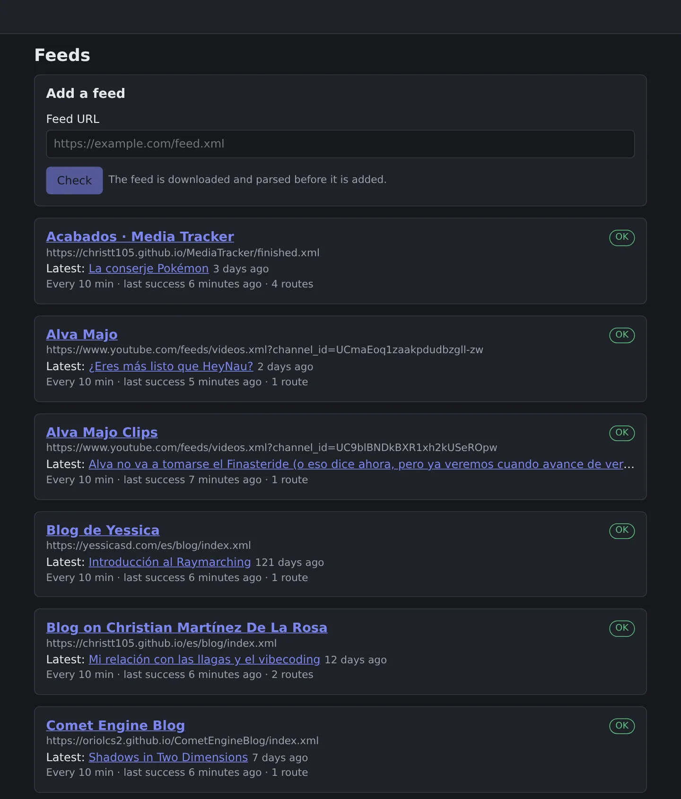
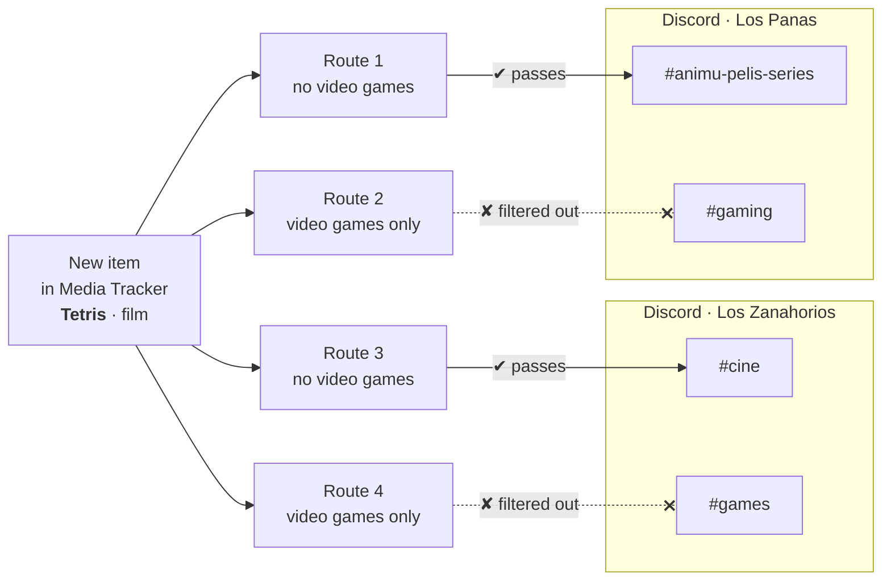
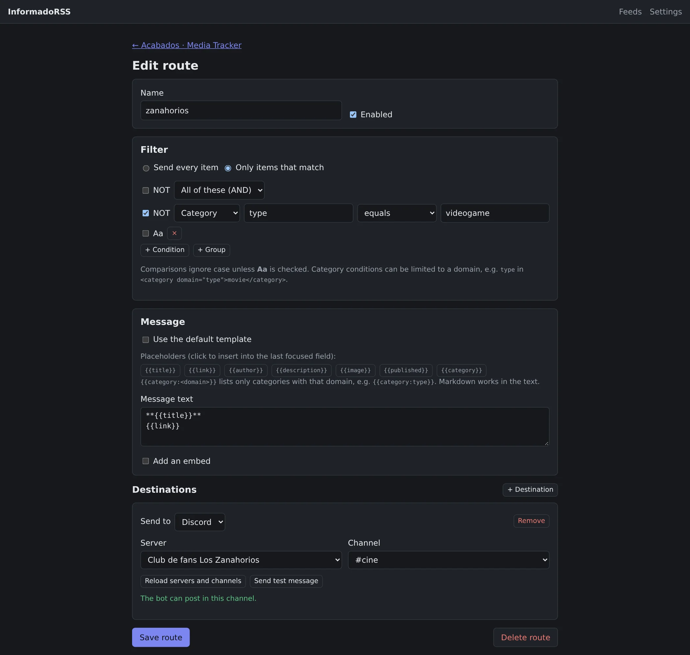
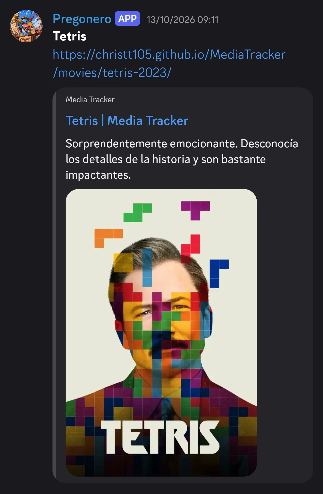
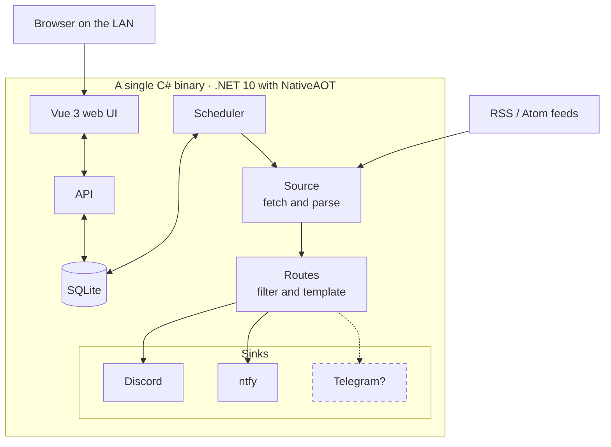
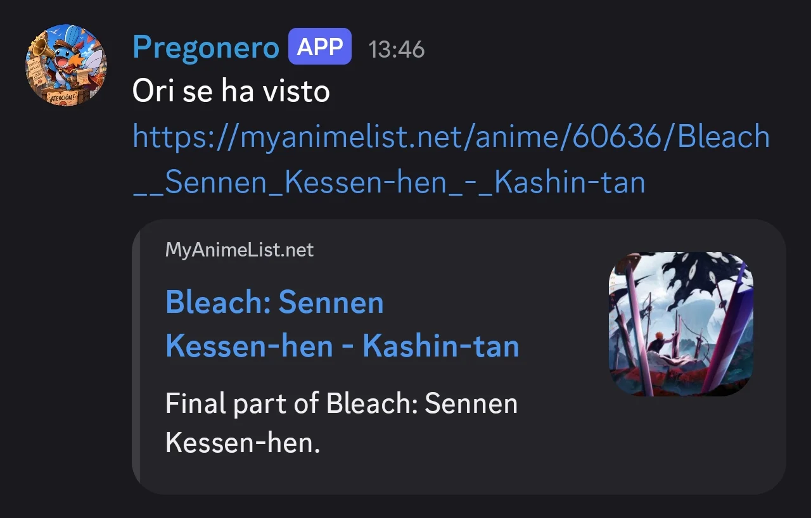
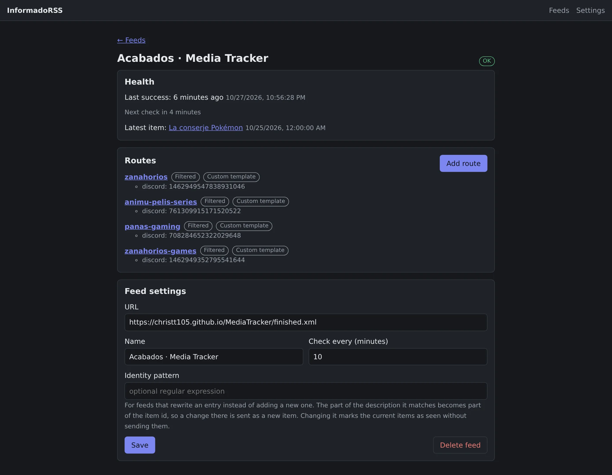

Hi again!

I have a couple of Discord servers where a bot announces new blog posts, YouTube videos, newsletters and my friends' anime and manga lists. For years that job was done by MonitoRSS. It works, but it's nine containers (several Node services, Mongo, Postgres, RabbitMQ...) and about 670 MB of RAM just to check every ten minutes whether a handful of feeds have something new. On a home server that already runs Jellyfin and half a dozen other things, that felt outrageous, and as you know, the world isn't in a position to give RAM away. So I made my own.

## What it is
InformadoRSS is a self-hosted service that watches RSS and Atom feeds, filters their items and sends them to Discord channels. One container, one SQLite file and a web UI served by the same binary. It's open source (MIT):



The idea is simple:

- A **feed** is a URL.
- A **route** says what to do with a feed: a filter, one or more destinations (a Discord channel or ntfy) and a message template.
- The web UI has a filter builder, a template editor and a server and channel picker, so you don't have to copy ids by hand.
- The bot only talks to Discord through the REST API. No gateway, no commands, no webhooks. As simple as that.
- When a feed or a destination breaks it sends me a single direct message on Discord, and another one when it recovers.

For example, the Media Tracker feed, where everything I finish watching or playing shows up, has four routes: on each server, films and series go to one channel and video games to another. When I finish Tetris, the item goes through all four routes and only reaches the channels that accept it:

## The stack
C# on .NET 10 compiled with NativeAOT, and a Vue 3 frontend that ends up as static files inside the same binary. I picked C# because it's what I use every day, and that's why I ruled out Go and C++. I was curious to try building something like this in one of those languages, but in the end C# is the one I'm most comfortable reading. Storage is SQLite, with a daily backup to another disk, although losing it wouldn't be a big deal.

This is what it looks like inside:

The idea is for everything to be modular. Each destination is a sink, a class that implements a very small interface: a name and a method that delivers the message. Right now there are two, Discord and ntfy, and adding another one, like Telegram, means writing that class and registering it, without touching the scheduler or the filters; the web UI picks it up on its own and offers it as a destination. Sources work the same way: today there's only RSS and Atom, but they sit behind their own interface.

## The numbers
Let's put the numbers on the table and compare both services at similar moments: idle, with the same feeds and checking every ten minutes. I've already shut MonitoRSS down for obvious reasons, so its figures are from before the switch.

| | InformadoRSS | MonitoRSS |
| --- | --- | --- |
| Containers | 1 | 9 |
| RAM | 75 MiB | about 670 MB |
| Image | 37 MB | about 3.9 GB combined |
| Data on disk | 4.5 MB | 656 MB |

Even though the numbers are very good, there's still room for improvement. In the first experiment, with no feeds and no web UI, the AOT binary used about 10 MiB, and in production it's 75 MiB: the .NET garbage collector is in no hurry to give memory back on a machine with 15 GB free. If it ever matters to me, I can cap the heap. It also writes about 50 MB a day to disk, mostly overly detailed logs from the HTTP client, which is fixed by lowering the log level.

## Made with Claude
First I wrote the design in an Obsidian note (what MonitoRSS does, what I actually use and what I can throw away) and then split it into tasks. Claude ran several of them in parallel in separate git worktrees, each with its own pull request, and I reviewed and merged them in waves: storage, filters and the feed parser, then the scheduler and Discord delivery, and finally the importer, alerts, backups and the web UI. I think I've found a very comfortable way of working with AI, I might write a post about how I work soon.

## The switch
The scary part wasn't the code, it was moving from one to the other. I wrote an importer that reads a MonitoRSS `mongoexport` and creates the feeds and routes. The first pass sent every destination to a test channel and posted the latest item of each feed, so I could compare the messages side by side. Once it all matched, I stopped the MonitoRSS containers, pointed the 22 routes at the real channels and silently marked them as seen so nobody got flooded with old posts. If anything went wrong, a `docker start` would bring the old stack back. Honestly, it came out almost perfect on the first try.

## Things that gave me trouble
- **YouTube feeds return 404 for a few hours every morning.** It's a global outage, not my IP. That's why a feed only counts as broken after failing for six hours straight. I don't really understand why this happens to YouTube. [It seems to be a bug that's been around for a while](https://www.reddit.com/r/youtube/comments/1r61jpo/all_youtube_channel_rss_feeds_are_down_return_404/).
- **MyAnimeList rewrites entries in place.** Each entry's guid is the anime's URL and the status lives in the description, so going from `Watching` to `Completed` was never sent. MonitoRSS had the same problem. Now a feed can have an identity pattern, a regular expression over the description that gets appended to the item id, so each status counts as a new item. Still, the way MAL organises its RSS is terrible (Ori, I won't say it again, add RSS to your tracking app).
- **Old items after an outage.** Items older than a maximum age are marked as seen without being sent, and from the web UI you can send or reset any of them by hand. This tends to happen to me because I take several days to write a post: I forget to update the date, it shows up as published several days ago and the delivery gets skipped.

## What's missing
It's a very basic service, it has exactly what I need. MonitoRSS has a lot more customisation and lets you do more things, but I don't need it, much less at the cost of using nine times more RAM.

Things like Discord messages with Components V2, a Discord-style message preview and a Shorts filter for YouTube are missing. There's no login: it's meant for a trusted LAN.

It's built to be quite modular, so I can add other sources or sinks, and if I need a feature I can add it easily: it's not a very complex service. For now I'll leave it like this, open for anyone who wants to use it or improve it.

If you use MonitoRSS and want something lighter, give it a try and take a look.

See you in the next one!
