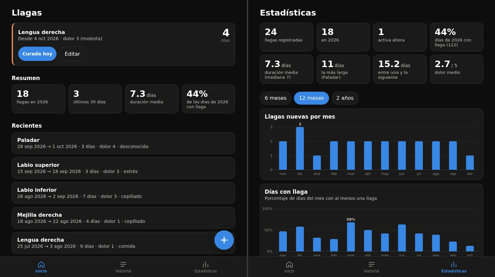
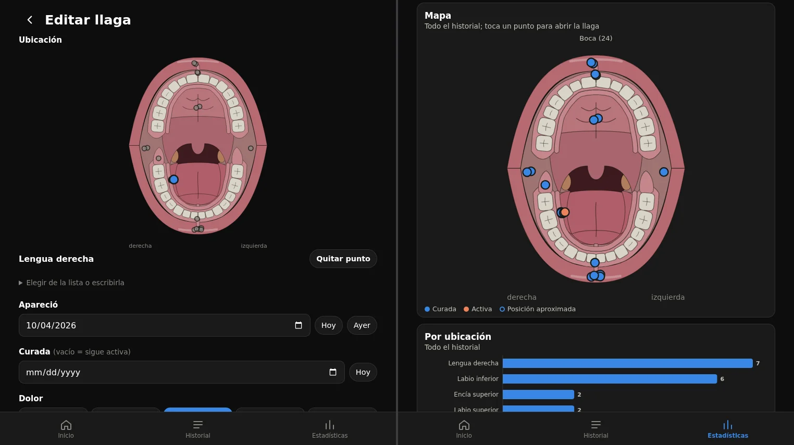
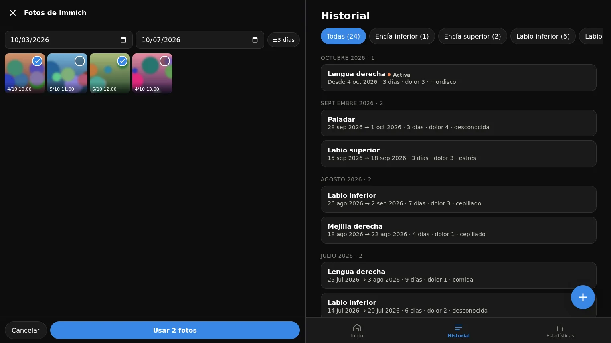

Hi again. Today's post is a bit different. I'm not going to talk about one of those projects I'm fond of and look after line by line, but the exact opposite: a web app I made in five minutes, whose code I haven't reviewed at all, and which I'm perfectly happy to keep that way.

It's called **Llagas** (Spanish for mouth sores), it keeps track of the sores I get in my mouth, and it's my excuse to talk about how I live with *vibecoding*.





## The problem

I get mouth sores quite often. Nothing serious, but enough that I want to know when they show up, how long they last, where, whether it was a bite or stress, and what helped them heal. Geek moment, the kind that makes a doctor look at you a little worried.

## What I already had in Obsidian

I wasn't starting from zero. I'd been logging them in Notion for a while. Later they moved to my Obsidian vault, one note per sore with a few properties:

```yaml
---
type: llaga
fecha_aparicion: 2026-06-19
fecha_desaparicion: 2026-07-03
ubicacion: Paladar
dolor:
causa_sospechada:
tratamiento:
---
```

And it worked. With a Bases view I had a table of all of them, and not much else. But it fell short in very specific ways:

- Logging a new sore from my phone had more friction than I wanted. If I have to open Obsidian, create the note, fill in the properties... I end up leaving it for later, and later means never.
- The location was free text. "Lower lip", "bottom lip", "lwr lip". Impossible to get decent statistics.
- Photos. Taking a picture of a sore to see how it evolves is useful, but my photos already live in [Immich](https://immich.app/), and I didn't want to duplicate them inside the vault.
- I wanted to **see where** they show up. Not a list of names, but a drawing of the mouth with the spots marked.

I could have made an Obsidian plugin or worked harder on the templates, but for what I wanted, something exclusive to this topic with exactly the tools I could think of, I needed something of my own.

## The solution: ask Claude

So I sat down with Claude, told it what I wanted and kept asking for things. In about five minutes I had a first working version. I asked for everything straight from my phone, and since it lives on my home server, it was done in no time. I've polished it since, but the important parts were there from the start:

- **Quick entry from the phone**, as an installable PWA. One button and done.
- **A map of the mouth**. A drawing of an open mouth, and you pick the location by tapping where the sore is. The location text fills itself in.
- **Immich photos**. The app only stores the photo IDs, it doesn't copy them. When editing a sore it shows me the photos I took on the days it lasted, I select them and they're added to an Immich album. I can also take a photo from the app itself.
- **Statistics**: how many per year, average duration, the longest one, how often they appear, in which areas, and a map with all of them.



All the images use generated demo data. I'm in bad shape but I can live well.

The Immich photos work the same way: I choose the date range and the app shows me the photos from that period so I can link them.



Afterwards I migrated all the sores I had in Obsidian to the new database with an import script, which also looks for the photos already linked in the notes and attaches them.

## I haven't reviewed any code

And here's what I really want to talk about: **I haven't looked at the code**. Not a single line. I don't know how it's structured, I don't know if there's anything weird in there, and I don't mind.

This, which in any of my other projects would be heresy, makes complete sense here for several reasons:

- **It's a simple project.** A web app for me, on my local network, with no accounts or users other than me. If it breaks, the worst that happens is I can't log a sore for a while.
- **The risk is minimal.** It doesn't touch anything important. It only stores some dates and photo identifiers.
- **It tests itself by being used.** If it works when I use it, it works. If something fails, I notice right away and tell Claude.
- **Its goal is to make my life easier**, not to be perfect. Not every project has to be.

And there's a point that seems even more important to me: **without AI I wouldn't even have considered it**. It would have taken far longer, I'd have had to learn things I don't care about for something so small, and I'd most likely have stayed with the Obsidian note. Vibecoding here didn't replace a project I would have made, it made possible one that wouldn't have existed.

## The other side: the projects I do care about

I don't want this to read as "leave everything in the hands of AI", because my relationship with it is **completely different depending on the project**.

I have other, more important projects that I'm very fond of, like [Elit3D](../elit3d-godot-update) or [Godosters](../godosters-origin). With those I go much slower. I also use AI to help, but I review every line, I don't let it get out of hand, and I decide how the code is organized and what gets accepted and what doesn't. If I have to choose between going fast and understanding everything, there I choose understanding everything.

I think part of "living with vibecoding" is exactly that: knowing when to let go and when not to. What I'd consider a mistake is applying the same criterion to everything, in either direction. Reviewing every line of Llagas would be a waste of time, and not reviewing anything in Elit3D would be irresponsible.

## How it's deployed

Since it's such a pleasant project to tinker with, I also published it as a Docker image on GitHub, and I run it on my home server next to the rest of my services. The basic setup is a `docker-compose` file with the address of my Immich and an API key:

```yaml
services:
  llagas:
    image: ghcr.io/christt105/llagas:${LLAGAS_TAG:-latest}
    restart: unless-stopped
    ports:
      - "8097:8080"
    environment:
      TZ: Europe/Madrid
      IMMICH_URL: http://immich.lan:2283
    env_file: .env
    volumes:
      - ./data:/data
```

It has no authentication, because it's meant for my local network (and Tailscale when I'm away from home). It's exactly the kind of decision you can make lightly in a project like this and would never make in one that serves other people's data.

## Conclusion

Llagas isn't a project I'd show in a job interview, and I don't want to. It's a small tool that solves a small problem, and I made it in five minutes.

If I take one thing away from this, it's that vibecoding doesn't have to be a label for "my code is bad" or a flag for "you no longer need to know how to program". It's one more tool, and what matters is choosing well where to use it. For the things I care about, I'll keep going slowly and checking everything. For the ones I just want to exist, I let myself go with the flow.

AI is here to stay, whether we like it or not, so now everyone can use it however they please.

If you're in the same boat as me and want to run it on your own server, the code is on [GitHub](https://github.com/christt105/llagas) with instructions. At your own risk though, since I haven't read it either, haha.

See you in the next post!
