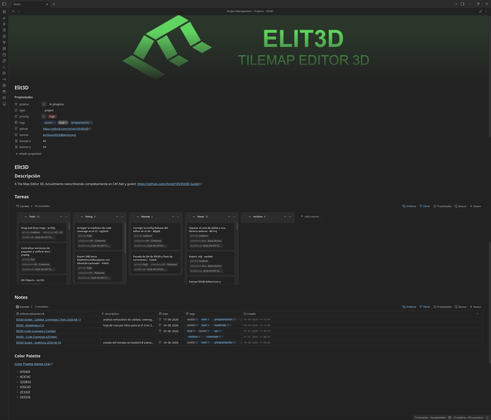
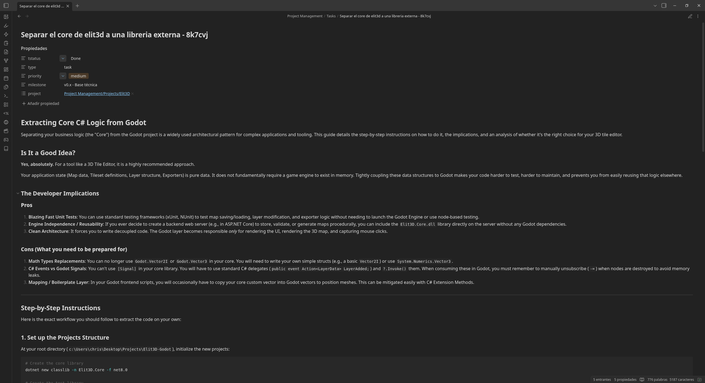
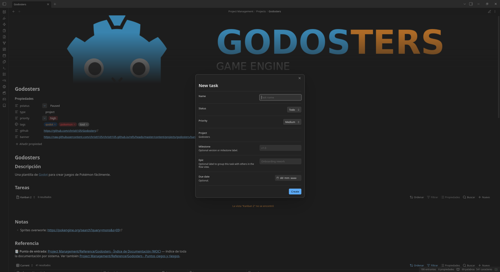
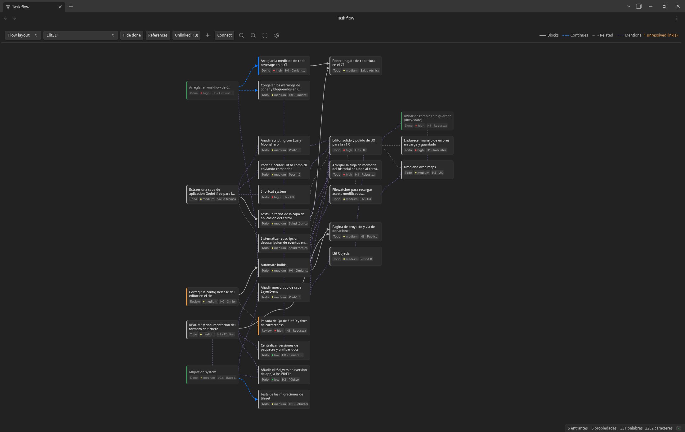
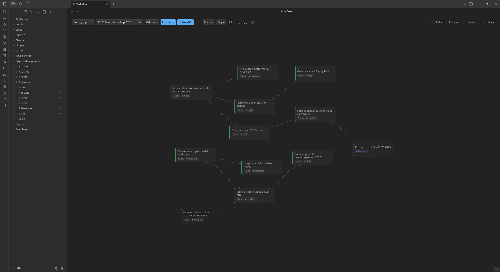
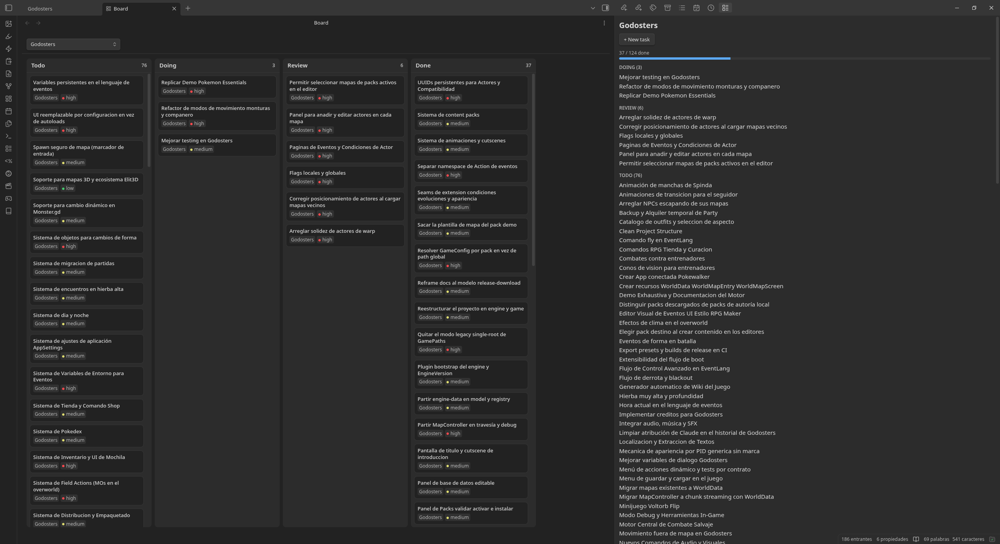
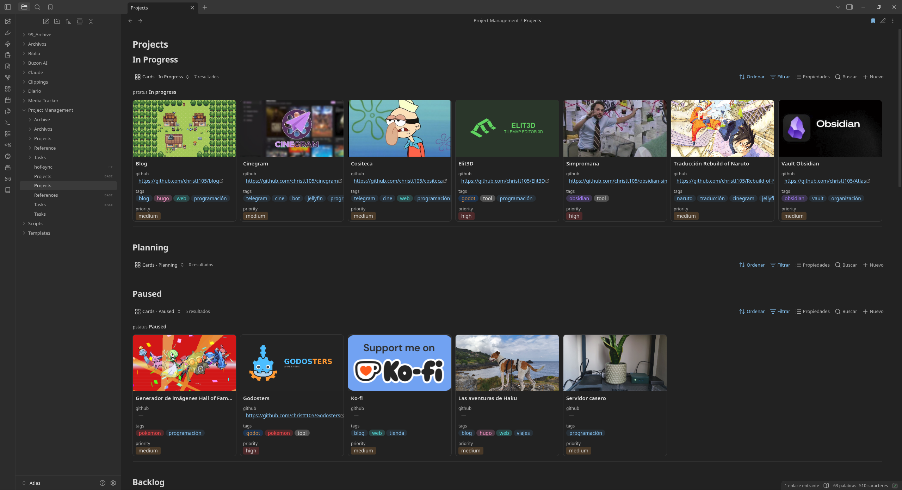

Hola de nou. Després de diversos posts parlant de [Media Tracker](../media-tracker-plugin) (el següent d'aquest projecte serà divertit) i de com havia acabat posant mitja vida dins d'Obsidian, avui toca l'altra meitat: com porto els meus projectes. Us presento Simpromana, un plugin d'Obsidian per gestionar projectes i tasques al vault. El nom surt del que volia que fos: **Sim**ple **Pro**ject **Mana**gement.



## El problema

Tinc molts projectes alhora: el blog, [Cinegram](../cinegram), Elit3D, [Godosters](../godosters-origin), Media Tracker, InformadoRSS... I molts que se m'ocorren sobre la marxa. Cadascun amb les seves tasques pendents, idees, auditories i notes de disseny. Durant molt de temps tot això va viure repartit entre el vault, Trello, Notion, Projects de GitHub, issues de GitHub i una nota gegant amb checkboxes que ningú tornava a obrir. I no tenia a mà la pregunta més bàsica: què és el següent que hauria de fer, i què depèn de què?

Vaig provar eines externes, però sempre acabava amb la informació en dos llocs i un dels dos es quedava desactualitzat. I entre els plugins que hi havia no en vaig trobar cap que m'ensenyés les dependències entre tasques, no només llistes i taulers. El meu vault és l'únic lloc que obro cada dia, així que la solució havia de viure allà.

## Notes amb frontmatter, res més

Simpromana no té base de dades ni format propi. Tot són notes de Markdown amb propietats, de tres tipus:

- `project` (`Projects/*.md`): un projecte, amb la seva descripció, estat, prioritat, enllaç al repo...
- `task` (`Tasks/Títol - abc123.md`): una tasca. Enllaça al seu projecte i té estat (`Todo`, `Doing`, `Review`, `Done`), prioritat i, si vols, fita, èpica i data límit.
- `reference` (`Reference/Títol - abc123.md`): auditories, investigacions i documents llargs que pengen d'un projecte però no són una tasca.

Les notes són meves: si el plugin desapareix demà (que ho dubto perquè és meu i Obsidian no depèn de servidors), segueixo tenint arxius `.md` perfectament llegibles. I cada tasca és una nota de veritat, així que puc escriure el que vulgui, enllaçar-la o obrir-la al mòbil.

El sufix amb l'ID (sis caràcters aleatoris) evita col·lisions entre tasques semblants ("Arreglar tests" existeix en cinc projectes) i fa que l'enllaç continuï funcionant encara que canviï el títol.

## Què fa

### Crear notes

Les ordres *New project*, *New task* i *New reference* obren un formulari i generen la nota amb les propietats correctes. És l'únic que necessitava automatitzar: escriure el frontmatter a mà és just el que fa que deixis d'apuntar coses. També hi ha *Archive current task*, que demana confirmació, marca la tasca com a arxivada i la mou a la carpeta d'arxiu.

### Vista de flux

És la que més m'agrada i la raó que comencés el projecte (*Open task flow*). Cada tasca pot relacionar-se amb altres mitjançant propietats:

- `blocked_by` (o `blocks`): no pot començar fins que acabi l'altra.
- `continues` (o `continued_by`): és la continuació natural d'una altra.
- `related`: estan connectades, sense més.

Si una nota menciona una altra amb un `[[enllaç]]` al cos, també surt com a relació de tipus menció, més tènue. Amb això el plugin dibuixa el graf del projecte: cada tasca amb el seu estat i prioritat, acolorida per estat, i les relacions com a fletxes.

Hi ha dos modes. El flow layout col·loca les tasques en columnes d'esquerra a dreta segons les seves dependències, i dibuixa dins d'un requadre les que comparteixen èpica. Les tasques sense relacions es poden mostrar a part, agrupades per estat, fita o prioritat. El force graph és el clàssic graf de forces, on pots arrossegar els nodes i fixar-los on vulguis.

La barra superior permet triar projecte, amagar el que està acabat i mostrar les referències o les tasques sense relacions. Amb el botó *Connect* relaciones dues tasques arrossegant de l'una a l'altra, sense tocar el frontmatter, i el plugin no deixa crear una dependència que tanqui un cicle.

### Tauler i panell de projecte

*Open board* és un kanban de tota la vida: columnes `Todo`, `Doing`, `Review` i `Done`, targetes que s'arrosseguen d'una a l'altra (cosa que canvia l'estat a la nota) i un filtre per projecte. *Open project panel* és el panell lateral de la captura: mostra el projecte de la nota que tinguis oberta, una barra de progrés (37 de 124 fetes a Godosters) i les seves tasques agrupades per estat, amb un botó de nova tasca a mà. No l'uso gaire, sincerament, ja que faig servir un plugin extern per al tauler kanban que funciona a partir de Bases.

### Bases

Obsidian inclou el plugin nucli Bases, que permet fer vistes de taula i targetes sobre les propietats de les notes. Simpromana l'aprofita en lloc de reinventar-lo: les notes de projecte incrusten un `Tasks.base` i un `References.base` filtrats pel seu projecte, i l'ordre *Setup bases* crea els que faltin sense sobreescriure els que ja existeixin. Les vistes de tauler de `Tasks.base` fan servir [Base Board](https://community.obsidian.md/plugins/base-board), que és el que recomano. Sense ell es queden en una taula normal.

## Com l'faig servir

Simpromana va néixer per treballar amb Claude tant com per treballar jo. Com que tot són notes de Markdown amb propietats, un agent pot llegir i escriure el mateix sistema que faig servir jo, sense APIs ni integracions: el vault és el punt de trobada. El meu dia a dia s'assembla a això:

1. **Apunto la idea.** Si se m'acudeix alguna cosa (un bug, una millora, un projecte nou), ho comento amb Claude o creo la tasca jo mateix. Cada tasca és una nota amb el seu projecte, la seva prioritat i el seu estat `Todo`.
2. **Investiguem abans de picar codi.** Si el tema és gran (una auditoria, comparar opcions, decidir una arquitectura), Claude ho escriu com una `reference` penjada del projecte, i d'allà surten les tasques concretes. Les relacions (`blocked_by`, `continues`, `related`) les omple ell al frontmatter, així que la vista de flux es va dibuixant sola i m'ensenya per on començar.
3. **Claude treballa la tasca.** La passa a `Doing`, fa els canvis en una branca, obre una PR i, en acabar, la passa a `Review` amb una secció *Fet* dins de la mateixa nota: què ha canviat, com ho ha verificat i quins caps solts queden. Aquesta nota és el rastre del que ha passat, així que no he de bussejar en l'historial d'un xat per recordar-ho.
4. **Jo reviso.** Aquesta és la regla que no negocio: Claude mai marca una tasca com a `Done`. Tot el que acaba es queda a `Review` fins que ho reviso i ho promociono. El tauler amb la columna `Review` és la meva safata d'entrada: l'obro, miro què espera el meu vistiplau i ho moc a `Done`.

Hi ha diversos detalls que fan que això funcioni:

- **Una tasca per cada cosa que acaba en commit o PR.** Si no existeix, Claude la crea abans de començar. Així res del que es fa queda sense rastre i el progrés de cada projecte és real, no una sensació.
- **Un graf millor que una llista.** Quan tinc diversos projectes oberts, obrir la vista de flux em diu què està bloquejat, què és continuació de què i què puc agafar ara mateix. És el que un tauler pla no em donava.
- **Les instruccions viuen al vault mateix.** Hi ha un arxiu de normes compartit (com es diuen les notes, quines propietats porten, el cicle d'estats, que no s'ha d'escriure `Done`) que Claude llegeix a cada sessió, tant des del meu PC com des del servidor de casa al qual em connecto des del mòbil. Si canvio una regla en un lloc, val a tot arreu.
- **Treball en paral·lel, però amb seny.** Puc tenir diverses sessions, cadascuna amb la seva tasca i la seva branca, i el tauler em diu en quin punt està cadascuna. El que no faig és deixar que s'acumulin massa PR sense revisar: aquest és el veritable nou coll d'ampolla amb la IA, no escriure codi.
- **Tot en text pla i amb git.** El vault té còpia en un repositori, així que abans d'una edició massiva es fa un commit de seguretat i, si alguna cosa surt malament, es torna enrere.

El que més m'ha sorprès és que el sistema funciona millor *perquè* és simple. Un agent rarament es perd amb tres tipus de nota, quatre estats i tres tipus de relació, i jo tampoc. És el mateix vocabulari per als dos, i això és just el que volia quan li vaig posar el nom de Simple Project Management.

## Com està fet

És TypeScript amb l'API d'Obsidian, i el vaig organitzar perquè la part difícil no en depengui. Llegir les notes és l'únic que toca l'API; construir el graf i calcular el layout són TypeScript pur, així que els cobreixo amb tests unitaris sense necessitat d'aixecar Obsidian. El canvas és propi, amb zoom i gestos per al mòbil, i el force graph és una simulació escrita a mà, sense llibreries de grafs: per a les desenes de nodes que manejo sobra. Aquesta separació també deixa oberta la porta a passar la vista de flux a una vista de Bases algun dia.

Les propietats i els estats que faig servir (`tstatus`, `pstatus`, `Todo/Doing/Review/Done`...) són els que vaig decidir, així que són tots configurables: carpetes, noms de propietats, estats i ordre de les columnes del tauler. L'únic fix són els valors de `type`. Els àlies de relacions també valen (`depends_on`, `follows`, `related_to`...), i aquestes propietats s'editen amb un cercador de tasques en lloc d'escriure enllaços a mà.

## Com provar-lo

1. A Obsidian, ves a *Configuració → Plugins de la comunitat → Explorar* i cerca Simpromana. També tens [la pàgina del plugin](https://community.obsidian.md/plugins/simpromana).
2. Activa'l i executa *Setup bases* si vols les vistes de tasques i referències.
3. Crea un projecte amb *New project*, un parell de tasques amb *New task*, i obre *Open task flow*, *Open board* o *Open project panel*.

Requereix Obsidian 1.13.0 o superior.

## Estat actual

La versió actual és la 0.4.0 i és el que faig servir a diari per a tots els meus projectes. El següent és convertir la vista de flux en una vista de Bases, per poder incrustar-la a la nota de projecte com la resta, i afegir més opcions d'agrupació i filtratge al graf.

Això sí, és un plugin amb opinions: les carpetes, els tipus de nota i el vocabulari de relacions giren al voltant de com organitzo jo el meu vault. Si t'encaixa, genial; si no, potser et servirà com a idea. Si el proves, explica'm què tal als comentaris o obre una issue al [repositori](https://github.com/christt105/obsidian-simpromana-plugin). I una estrella sempre s'agraeix.

Fins a la propera!
