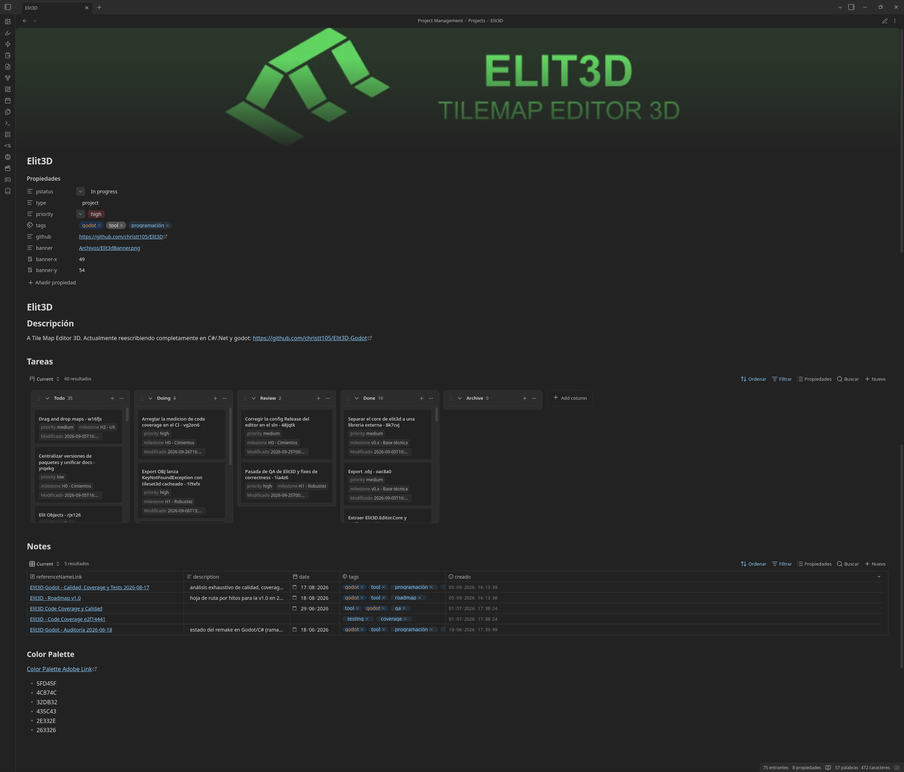
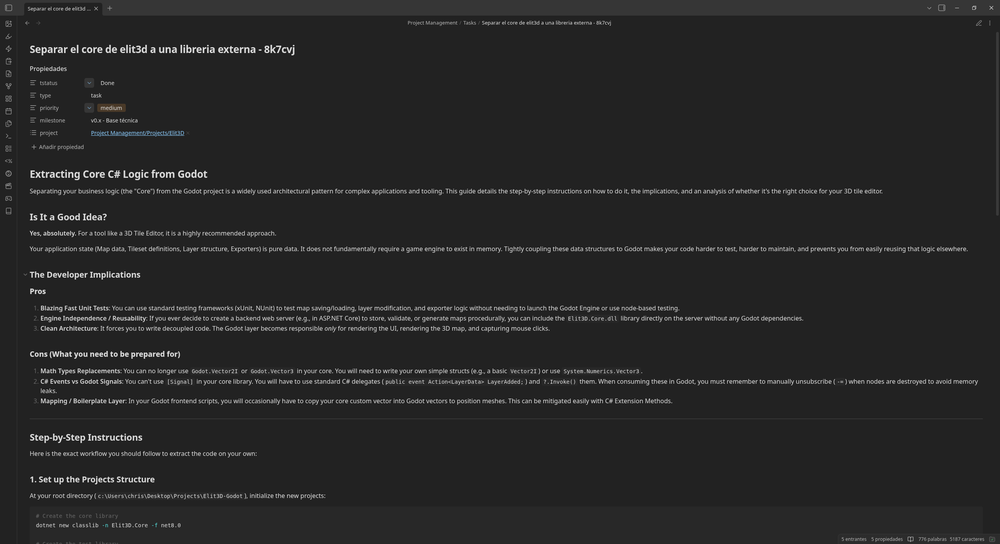
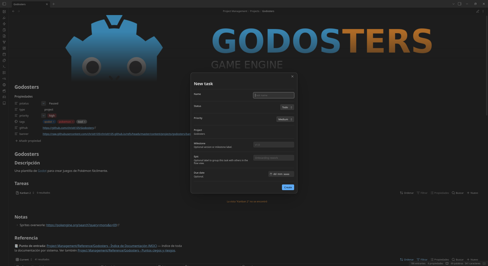
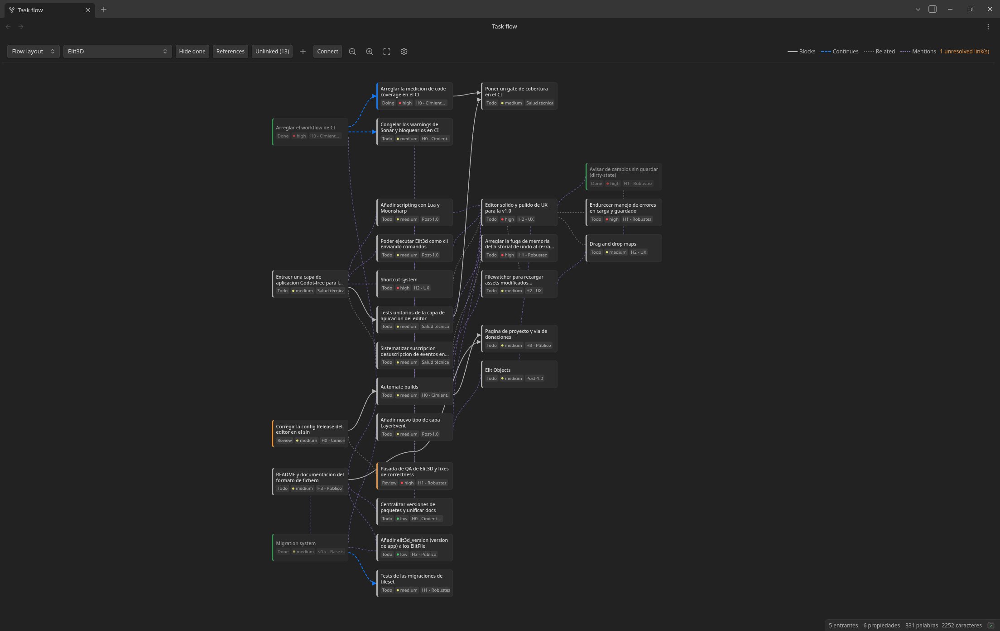
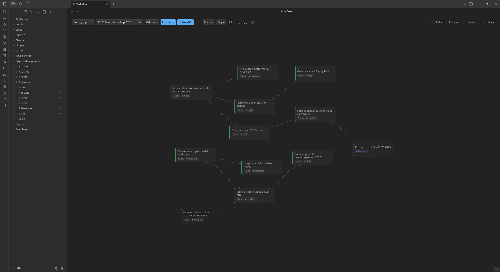
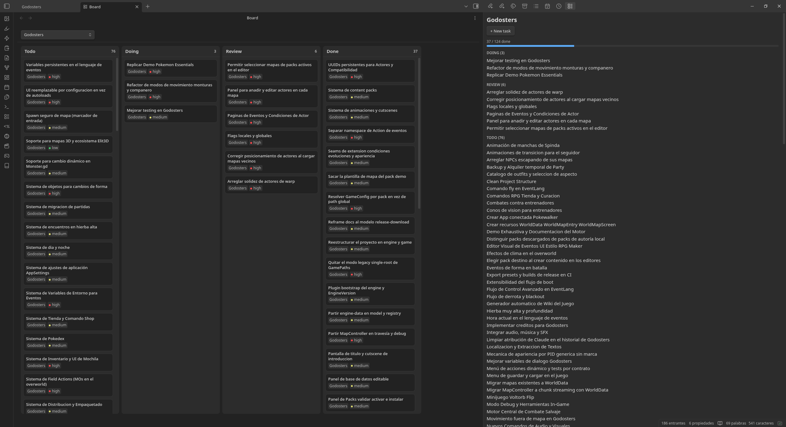
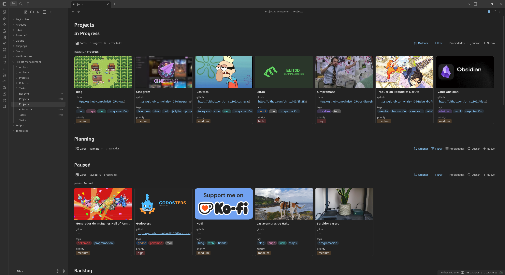

Hola de nuevo. Después de varios posts hablando de [Media Tracker](../media-tracker-plugin) (el siguiente de este proyecto va a estar gracioso) y de cómo había acabado metiendo media vida dentro de Obsidian, hoy toca la otra mitad: cómo llevo mis proyectos. Os presento Simpromana, un plugin de Obsidian para gestionar proyectos y tareas en el vault. El nombre sale de lo que quería que fuera: **Sim**ple **Pro**ject **Mana**gement.



## El problema

Tengo muchos proyectos a la vez: el blog, [Cinegram](../cinegram), Elit3D, [Godosters](../godosters-origin), Media Tracker, InformadoRSS... Y muchos que se me van ocurriendo sobre la marcha. Cada uno con sus tareas pendientes, ideas, auditorías y notas de diseño. Durante mucho tiempo eso vivió repartido entre el vault, Trello, Notion, Projects de GitHub, issues de GitHub y una nota gigante con checkboxes que nadie volvía a abrir. Y no tenía a mano la pregunta más básica: ¿qué es lo siguiente que debería hacer, y qué depende de qué?

Probé herramientas externas, pero siempre acababa con la información en dos sitios y uno de los dos se quedaba desactualizado. Y entre los plugins que había no encontré ninguno que me enseñara las dependencias entre tareas, no solo listas y tableros. Mi vault es el único sitio que abro todos los días, así que la solución tenía que vivir ahí.

## Notas con frontmatter, nada más

Simpromana no tiene base de datos ni formato propio. Todo son notas de Markdown con propiedades, de tres tipos:

- `project` (`Projects/*.md`): un proyecto, con su descripción, estado, prioridad, enlace al repo...
- `task` (`Tasks/Título - abc123.md`): una tarea. Enlaza a su proyecto y tiene estado (`Todo`, `Doing`, `Review`, `Done`), prioridad y, si quieres, hito, épica y fecha límite.
- `reference` (`Reference/Título - abc123.md`): auditorías, investigaciones y documentos largos que cuelgan de un proyecto pero no son una tarea.

Las notas son mías: si el plugin desaparece mañana (que lo dudo porque es mío y Obsidian no depende de servidores), sigo teniendo archivos `.md` perfectamente legibles. Y cada tarea es una nota de verdad, así que puedo escribir lo que quiera en ella, enlazarla o abrirla en el móvil.

El sufijo con el ID (seis caracteres aleatorios) evita colisiones entre tareas parecidas ("Arreglar tests" existe en cinco proyectos) y hace que el enlace siga funcionando aunque cambie el título.

## Qué hace

### Crear notas

Los comandos *New project*, *New task* y *New reference* abren un formulario y generan la nota con las propiedades correctas. Es lo único que necesitaba automatizar: escribir el frontmatter a mano es justo lo que hace que dejes de apuntar cosas. También hay *Archive current task*, que pide confirmación, marca la tarea como archivada y la mueve a la carpeta de archivo.

### Vista de flujo

Es la que más me gusta y la razón de que empezara el proyecto (*Open task flow*). Cada tarea puede relacionarse con otras mediante propiedades:

- `blocked_by` (o `blocks`): no puede empezar hasta que termine la otra.
- `continues` (o `continued_by`): es la continuación natural de otra.
- `related`: están conectadas, sin más.

Si una nota menciona a otra con un `[[enlace]]` en el cuerpo, también sale como relación de tipo mención, más tenue. Con eso el plugin dibuja el grafo del proyecto: cada tarea con su estado y su prioridad, coloreada por estado, y las relaciones como flechas.

Hay dos modos. El flow layout coloca las tareas en columnas de izquierda a derecha según sus dependencias, y dibuja dentro de un recuadro las que comparten épica. Las tareas sin relaciones se pueden mostrar aparte, agrupadas por estado, hito o prioridad. El force graph es el clásico grafo de fuerzas, donde puedes arrastrar los nodos y fijarlos donde quieras.

La barra superior permite elegir proyecto, ocultar lo terminado y mostrar las referencias o las tareas sin relaciones. Con el botón *Connect* relacionas dos tareas arrastrando de una a otra, sin tocar el frontmatter, y el plugin no deja crear una dependencia que cierre un ciclo.

### Tablero y panel de proyecto

*Open board* es un kanban de toda la vida: columnas `Todo`, `Doing`, `Review` y `Done`, tarjetas que se arrastran de una a otra (lo que cambia el estado en la nota) y un filtro por proyecto. *Open project panel* es el panel lateral de la captura: muestra el proyecto de la nota que tengas abierta, una barra de progreso (37 de 124 hechas en Godosters) y sus tareas agrupadas por estado, con un botón de nueva tarea a mano. No lo uso mucho sinceramente, ya que uso un plugin externo para el tablero kanban que funciona a partir de Bases.

### Bases

Obsidian incluye el plugin núcleo Bases, que permite hacer vistas de tabla y tarjetas sobre las propiedades de las notas. Simpromana lo aprovecha en vez de reinventarlo: las notas de proyecto incrustan un `Tasks.base` y un `References.base` filtrados por su proyecto, y el comando *Setup bases* crea los que falten sin sobrescribir los que ya existan. Las vistas de tablero de `Tasks.base` usan [Base Board](https://community.obsidian.md/plugins/base-board), que es el que recomiendo. Sin él se quedan en una tabla normal.

## Cómo lo uso yo

Simpromana nació para trabajar con Claude tanto como para trabajar yo. Como todo son notas de Markdown con propiedades, un agente puede leer y escribir el mismo sistema que uso yo, sin APIs ni integraciones: el vault es el punto de encuentro. Mi día a día se parece a esto:

1. **Apunto la idea.** Si se me ocurre algo (un bug, una mejora, un proyecto nuevo), lo comento con Claude o creo la tarea yo mismo. Cada tarea es una nota con su proyecto, su prioridad y su estado `Todo`.
2. **Investigamos antes de picar código.** Si el tema es grande (una auditoría, comparar opciones, decidir una arquitectura), Claude lo escribe como una `reference` colgada del proyecto, y de ahí salen las tareas concretas. Las relaciones (`blocked_by`, `continues`, `related`) las rellena él en el frontmatter, así que la vista de flujo se va dibujando sola y me enseña por dónde empezar.
3. **Claude trabaja la tarea.** La pasa a `Doing`, hace los cambios en una rama, abre una PR y, al terminar, la pasa a `Review` con una sección *Hecho* dentro de la propia nota: qué cambió, cómo lo verificó y qué cabos sueltos quedan. Esa nota es el rastro de lo que pasó, así que no tengo que bucear en el historial de un chat para recordarlo.
4. **Yo reviso.** Esta es la regla que no negocio: Claude nunca marca una tarea como `Done`. Todo lo que termina se queda en `Review` hasta que yo lo reviso y lo promociono. El tablero con la columna `Review` es mi bandeja de entrada: lo abro, miro qué espera mi visto bueno y lo muevo a `Done`.

Hay varios detalles que hacen que esto funcione:

- **Una tarea por cada cosa que acaba en commit o PR.** Si no existe, Claude la crea antes de empezar. Así nada de lo que se hace queda sin rastro y el progreso de cada proyecto es real, no una sensación.
- **Un grafo mejor que una lista.** Cuando tengo varios proyectos abiertos, abrir la vista de flujo me dice qué está bloqueado, qué es continuación de qué y qué puedo coger ahora mismo. Es lo que un tablero plano no me daba.
- **Las instrucciones viven en el propio vault.** Hay un archivo de normas compartido (cómo se llaman las notas, qué propiedades llevan, el ciclo de estados, que no hay que escribir `Done`) que Claude lee en cada sesión, tanto desde mi PC como desde el servidor de casa al que me conecto desde el móvil. Si cambio una regla en un sitio, vale en todos.
- **Trabajo en paralelo, pero con cabeza.** Puedo tener varias sesiones, cada una con su tarea y su rama, y el tablero me dice en qué punto está cada una. Lo que no hago es dejar que se acumulen demasiadas PR sin revisar: ese es el verdadero nuevo cuello de botella con la IA, no escribir código.
- **Todo en texto plano y con git.** El vault tiene copia en un repositorio, así que antes de una edición masiva se hace un commit de seguridad y, si algo sale mal, se vuelve atrás.

Lo que más me ha sorprendido es que el sistema funciona mejor *porque* es simple. Un agente rara vez se pierde con tres tipos de nota, cuatro estados y tres tipos de relación, y yo tampoco. Es el mismo vocabulario para los dos, y eso es justo lo que quería cuando le puse el nombre de Simple Project Management.

## Cómo está hecho

Es TypeScript con la API de Obsidian, y lo organicé para que la parte difícil no dependa de ella. Leer las notas es lo único que toca la API; construir el grafo y calcular el layout son TypeScript puro, así que los cubro con tests unitarios sin necesidad de levantar Obsidian. El canvas es propio, con zoom y gestos para el móvil, y el force graph es una simulación escrita a mano, sin librerías de grafos: para las decenas de nodos que manejo sobra. Esa separación también deja abierta la puerta a pasar la vista de flujo a una vista de Bases algún día.

Las propiedades y los estados que uso (`tstatus`, `pstatus`, `Todo/Doing/Review/Done`...) son los que decidí, así que son todos configurables: carpetas, nombres de propiedades, estados y orden de las columnas del tablero. Lo único fijo son los valores de `type`. Los alias de relaciones también valen (`depends_on`, `follows`, `related_to`...), y esas propiedades se editan con un buscador de tareas en vez de escribir enlaces a mano.

## Cómo probarlo

1. En Obsidian, ve a *Ajustes → Plugins de la comunidad → Explorar* y busca Simpromana. También tienes [la página del plugin](https://community.obsidian.md/plugins/simpromana).
2. Actívalo y ejecuta *Setup bases* si quieres las vistas de tareas y referencias.
3. Crea un proyecto con *New project*, un par de tareas con *New task*, y abre *Open task flow*, *Open board* u *Open project panel*.

Requiere Obsidian 1.13.0 o superior.

## Estado actual

La versión actual es la 0.4.0 y es lo que uso a diario para todos mis proyectos. Lo siguiente es convertir la vista de flujo en una vista de Bases, para poder incrustarla en la nota de proyecto como el resto, y añadir más opciones de agrupación y filtrado en el grafo.

Eso sí, es un plugin con opiniones: las carpetas, los tipos de nota y el vocabulario de relaciones giran en torno a cómo organizo yo mi vault. Si te encaja, genial; si no, quizá te sirva como idea. Si lo pruebas, cuéntame qué tal en los comentarios o abre una issue en el [repositorio](https://github.com/christt105/obsidian-simpromana-plugin). Y una estrella siempre se agradece.

¡Hasta la próxima!
