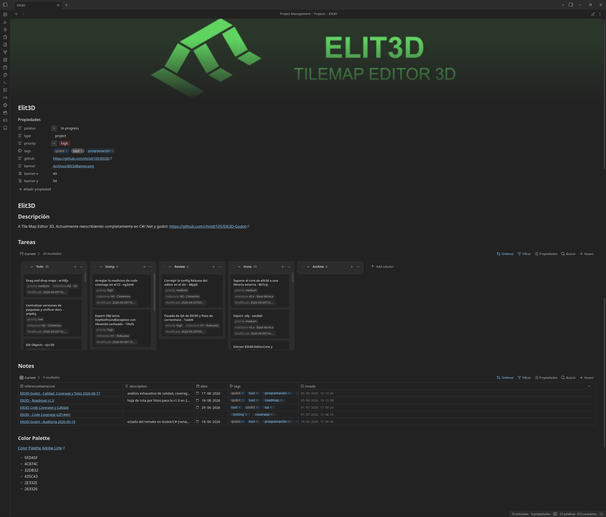
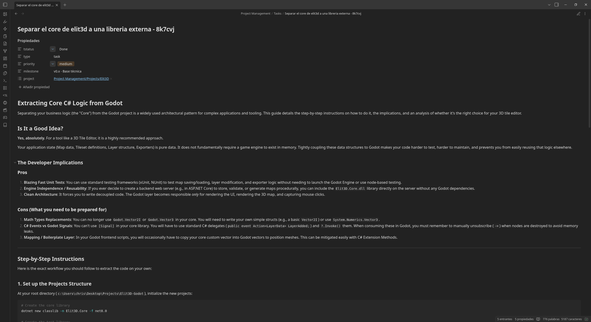
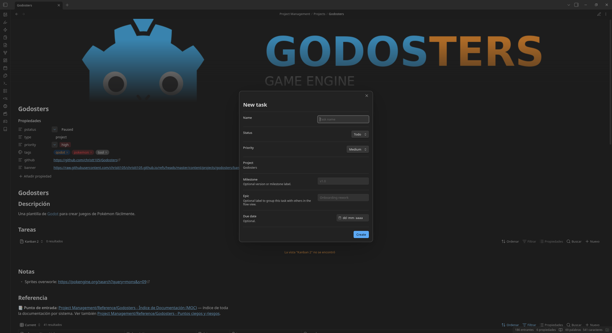
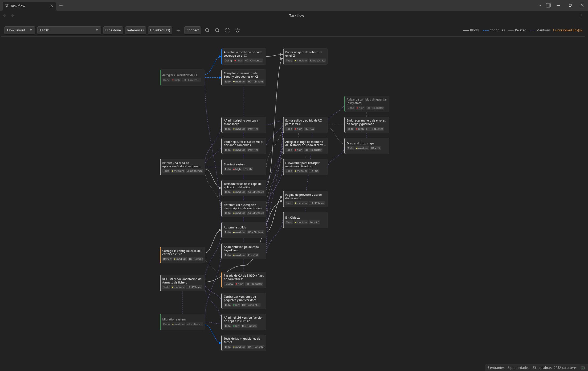
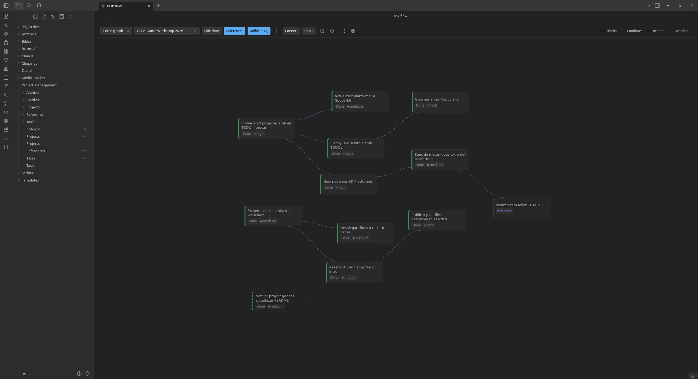
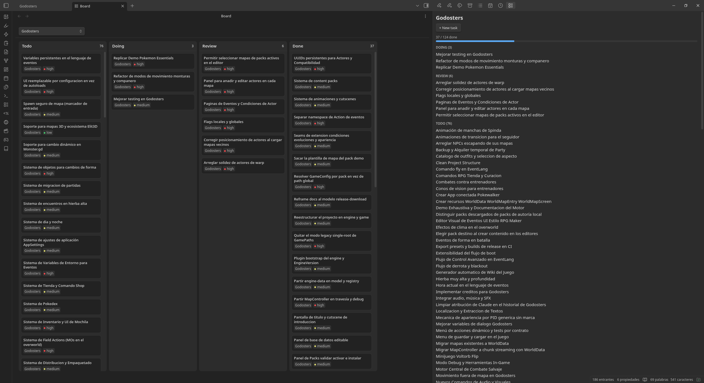
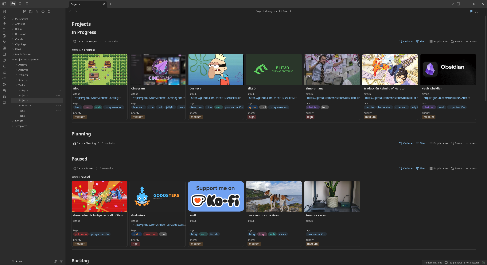

Hello again. After several posts about [Media Tracker](../media-tracker-plugin) (the next one for this project is going to be fun) and how I ended up putting half my life inside Obsidian, today it's the other half: how I run my projects. Meet Simpromana, an Obsidian plugin to manage projects and tasks in the vault. The name comes from what I wanted it to be: **Sim**ple **Pro**ject **Mana**gement.



## The problem

I have many projects at once: the blog, [Cinegram](../cinegram), Elit3D, [Godosters](../godosters-origin), Media Tracker, InformadoRSS... plus many more that pop into my head along the way. Each one has its pending tasks, ideas, audits and design notes. For a long time all of that lived scattered across the vault, Trello, Notion, GitHub Projects, GitHub issues and a giant note full of checkboxes that nobody ever reopened. And I didn't have the most basic question at hand: what should I do next, and what depends on what?

I tried external tools, but I always ended up with the information in two places and one of them going stale. And among the existing plugins I couldn't find any that showed me the dependencies between tasks, not just lists and boards. My vault is the only place I open every day, so the solution had to live there.

## Notes with frontmatter, nothing else

Simpromana has no database and no format of its own. Everything is Markdown notes with properties, of three types:

- `project` (`Projects/*.md`): a project, with its description, status, priority, repo link...
- `task` (`Tasks/Title - abc123.md`): a task. It links to its project and has a status (`Todo`, `Doing`, `Review`, `Done`), a priority and, if you want, a milestone, an epic and a due date.
- `reference` (`Reference/Title - abc123.md`): audits, research and long documents that hang off a project but aren't a task.

The notes are mine: if the plugin disappears tomorrow (which I doubt, since it's mine and Obsidian doesn't depend on servers), I still have perfectly readable `.md` files. And every task is a real note, so I can write whatever I want in it, link it or open it on my phone.

The ID suffix (six random characters) avoids collisions between similar tasks ("Fix tests" exists in five projects) and keeps the link working even if the title changes.

## What it does

### Creating notes

The *New project*, *New task* and *New reference* commands open a form and generate the note with the right properties. It's the only thing I needed to automate: writing the frontmatter by hand is exactly what makes you stop writing things down. There's also *Archive current task*, which asks for confirmation, marks the task as archived and moves it to the archive folder.

### Flow view

This is my favorite and the reason I started the project (*Open task flow*). Each task can relate to others through properties:

- `blocked_by` (or `blocks`): it can't start until the other one is finished.
- `continues` (or `continued_by`): it's the natural continuation of another.
- `related`: they're connected, nothing more.

If a note mentions another with a `[[link]]` in its body, it also shows up as a mention-type relation, fainter. With that the plugin draws the project graph: each task with its status and priority, colored by status, and the relations as arrows.

There are two modes. The flow layout places tasks in columns from left to right according to their dependencies, and draws a box around those that share an epic. Tasks with no relations can be shown separately, grouped by status, milestone or priority. The force graph is the classic force-directed graph, where you can drag the nodes and pin them wherever you like.

The top bar lets you pick a project, hide finished work and show references or tasks without relations. With the *Connect* button you relate two tasks by dragging from one to the other, without touching the frontmatter, and the plugin won't let you create a dependency that closes a cycle.

### Board and project panel

*Open board* is a classic kanban: `Todo`, `Doing`, `Review` and `Done` columns, cards you drag from one to another (which changes the status in the note) and a project filter. *Open project panel* is the side panel in the screenshot: it shows the project of the note you have open, a progress bar (37 of 124 done in Godosters) and its tasks grouped by status, with a new task button at hand. Honestly I don't use it much, since I use an external plugin for the kanban board that works on top of Bases.

### Bases

Obsidian ships with the core Bases plugin, which lets you build table and card views over the properties of your notes. Simpromana takes advantage of it instead of reinventing it: project notes embed a `Tasks.base` and a `References.base` filtered by their project, and the *Setup bases* command creates the missing ones without overwriting the ones that already exist. The board views of `Tasks.base` use [Base Board](https://community.obsidian.md/plugins/base-board), which is the one I recommend. Without it they fall back to a normal table.

## How I use it

Simpromana was born to work with Claude as much as for me to work with it. Since everything is Markdown notes with properties, an agent can read and write the same system I use, with no APIs or integrations: the vault is the meeting point. My day to day looks like this:

1. **I jot down the idea.** If something comes to mind (a bug, an improvement, a new project), I talk it over with Claude or create the task myself. Each task is a note with its project, its priority and its `Todo` status.
2. **We research before writing code.** If the topic is big (an audit, comparing options, deciding on an architecture), Claude writes it up as a `reference` attached to the project, and the concrete tasks come out of it. The relations (`blocked_by`, `continues`, `related`) are filled in by it in the frontmatter, so the flow view draws itself and shows me where to start.
3. **Claude works the task.** It moves it to `Doing`, makes the changes on a branch, opens a PR and, when done, moves it to `Review` with a *Done* section inside the note itself: what changed, how it verified it and what loose ends remain. That note is the trail of what happened, so I don't have to dig through a chat history to remember.
4. **I review.** This is the rule I don't negotiate: Claude never marks a task as `Done`. Everything it finishes stays in `Review` until I review it and promote it. The board with the `Review` column is my inbox: I open it, see what's waiting for my approval and move it to `Done`.

A few details make this work:

- **One task for everything that ends up as a commit or a PR.** If it doesn't exist, Claude creates it before starting. That way nothing that gets done is left without a trail and each project's progress is real, not a feeling.
- **A graph beats a list.** When I have several projects open, the flow view tells me what's blocked, what continues what and what I can pick up right now. It's what a flat board never gave me.
- **The instructions live in the vault itself.** There's a shared rules file (how notes are named, which properties they carry, the status cycle, that `Done` must not be written) that Claude reads every session, both from my PC and from the home server I connect to from my phone. If I change a rule in one place, it applies everywhere.
- **Working in parallel, but carefully.** I can have several sessions, each with its own task and branch, and the board shows me where each one stands. What I avoid is letting too many unreviewed PRs pile up: that's the real new bottleneck with AI, not writing code.
- **Everything in plain text and git.** The vault is backed up in a repository, so before a bulk edit a safety commit is made and, if something goes wrong, you roll back.

What has surprised me most is that the system works better *because* it's simple. An agent rarely gets lost with three note types, four statuses and three kinds of relation, and neither do I. It's the same vocabulary for both of us, and that's exactly what I wanted when I named it Simple Project Management.

## How it's built

It's TypeScript with the Obsidian API, and I organized it so the hard part doesn't depend on it. Reading the notes is the only thing that touches the API; building the graph and computing the layout are pure TypeScript, so I cover them with unit tests without having to spin up Obsidian. The canvas is custom, with zoom and gestures for mobile, and the force graph is a hand-written simulation, with no graph libraries: for the dozens of nodes I handle, it's plenty. That separation also leaves the door open to turning the flow view into a Bases view someday.

The properties and statuses I use (`tstatus`, `pstatus`, `Todo/Doing/Review/Done`...) are the ones I decided on, so they're all configurable: folders, property names, statuses and the order of the board columns. The only fixed thing is the `type` values. Relation aliases also work (`depends_on`, `follows`, `related_to`...), and those properties are edited with a task picker instead of typing links by hand.

## How to try it

1. In Obsidian, go to *Settings → Community plugins → Browse* and search for Simpromana. You also have [the plugin page](https://community.obsidian.md/plugins/simpromana).
2. Enable it and run *Setup bases* if you want the task and reference views.
3. Create a project with *New project*, a couple of tasks with *New task*, and open *Open task flow*, *Open board* or *Open project panel*.

Requires Obsidian 1.13.0 or higher.

## Current status

The current version is 0.4.0 and it's what I use daily for all my projects. Next up is turning the flow view into a Bases view, so it can be embedded in the project note like the rest, and adding more grouping and filtering options to the graph.

That said, it's an opinionated plugin: the folders, note types and relation vocabulary revolve around how I organize my vault. If it fits you, great; if not, maybe it'll work as an idea. If you try it, tell me how it goes in the comments or open an issue in the [repository](https://github.com/christt105/obsidian-simpromana-plugin). And a star is always appreciated.

See you next time!
