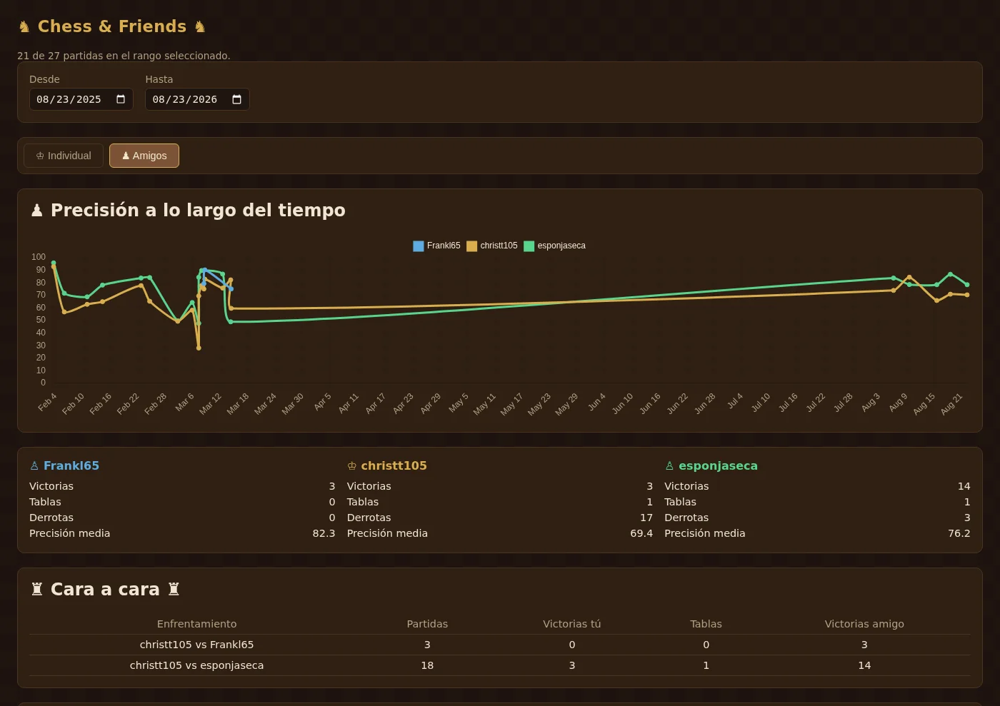

`Chess & Friends` is a small website that tracks the accuracy and results of the chess.com games I play against my brothers and shows how they evolve over time. It pulls everything from the public chess.com API, with no API key and no local engine analysis.

Key features:

- **Individual view**: My accuracy evolution and my numbers on their own.
- **Friends view**: A comparison between everyone in the group, with a head-to-head table.
- **Automatic data**: A Node script fetches the games from the API and saves them to a `games.json`, and closed months are cached so only the current one is requested again.
- **Zero maintenance**: A static page with no build step or frameworks, which refreshes itself so it never needs me to touch it.

It started as a joke to keep score of the beatings my brothers give me. Read the whole story in [the blog post](/blog/chess-and-friends/).

