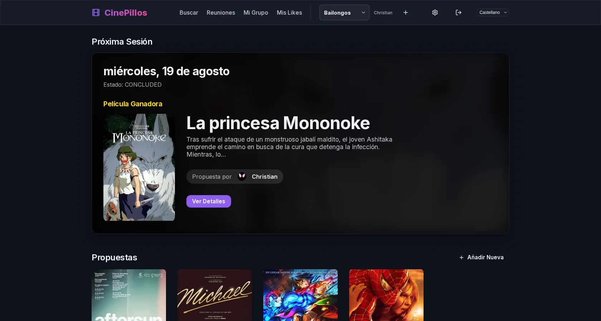

`Cinepillos` (antes "Club de Cine") es una web de código abierto para organizar noches de cine con amigos. Un grupo mantiene un tablero compartido de películas sugeridas, programa una sesión y vota cuál de ellas ver.

Características principales:

- **Tablero de sugerencias compartido**: Cualquier miembro puede añadir una película buscándola en la propia web, con TMDB de fondo.
- **Sesiones y votaciones**: Cada sesión tiene fecha y hora, se abre una ronda de votación entre las sugerencias y gana la película más votada.
- **Grupos privados**: Una misma instancia puede alojar varios clubes a la vez, y nadie ve nada de otro club.
- **Avatares de TMDB y TVDB**: Elige un póster de película o una foto de un personaje como avatar.
- **Stack y hosting**: Next.js, Prisma y Postgres, desplegado en Vercel con Neon, con inicio de sesión de Google. También se puede alojar uno mismo con Docker Compose.

Se publica con licencia AGPL-3.0. Cuento cómo surgió en [el post del blog](/es/blog/cinepillos/).

