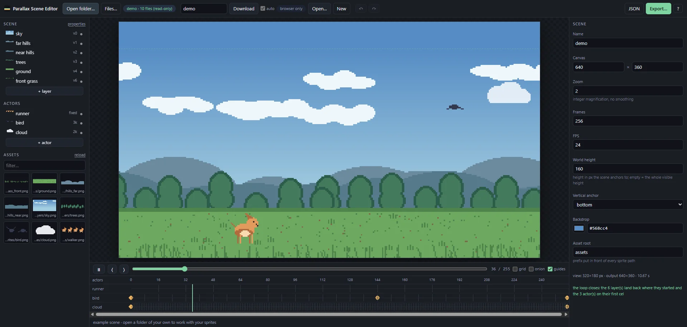

`Parallax Scene Editor` és un editor d'escenes parallax de pixel art en bucle. S'obre al navegador, llegeix una carpeta del teu propi disc plena de sprites i exporta GIF, WebM o una seqüència de PNG. No hi ha servidor, ni pas de build, ni es puja res enlloc. És de codi obert amb llicència MIT.

Un fons parallax és fàcil de dibuixar i una nosa de muntar: cada capa es mou a la seva pròpia velocitat i tot ha de cabre en el mateix nombre de fotogrames perquè el bucle no faci salts. Aquí una escena és un únic fitxer JSON amb càmera, capes, actors i keyframes, i l'editor t'avisa en vermell quan alguna cosa no tancarà.

Característiques principals:

- **Treballa sobre la teva pròpia carpeta**: Llegeix els sprites d'una carpeta del teu disc, i el fitxer de l'escena segueix l'editor, desant-se sol un moment després de cada canvi.
- **Recàrrega en viu de sprites**: Repinta un sprite al teu editor de pixel art, desa, i s'actualitza al llenç per si sol.
- **Capes, actors i keyframes**: Les posicions porten keyframes i s'interpolen, i edites mentre veus l'escena reproduir-se en bucle.
- **Comprovació del bucle**: L'editor t'avisa quan el bucle no tancarà.
- **Exportació**: GIF, WebM o seqüència de PNG, a més d'una exportació en paquet per endur-te l'escena a un altre lloc.

Obrir carpetes amb permís d'escriptura necessita la File System Access API, que només està en navegadors d'escriptori basats en Chromium. Als altres s'usa una còpia de només lectura.



