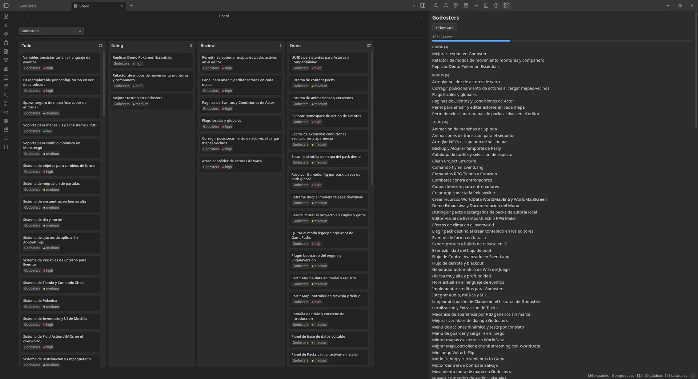

`Simpromana` es un plugin de [Obsidian](https://obsidian.md/) para gestionar proyectos y tareas. Mantiene conectadas las notas de `Projects`, `Tasks` y `Reference` mediante frontmatter, de modo que todo vive en tu vault en lugar de en un servicio externo. Es de código abierto con licencia MIT y está disponible en los plugins de la comunidad de Obsidian.

Características principales:

- **Vista de flujo**: Un grafo de tareas y sus relaciones (`blocked_by`, `continues`, `related`), agrupado y colocado automáticamente.
- **Vista de tablero**: Un tablero kanban (Todo/Doing/Review/Done) con cambios de estado arrastrando y un filtro opcional por proyecto.
- **Panel de proyecto**: Un panel lateral que lista las tareas de un proyecto por estado, con creación rápida de tareas.
- **Comandos**: *New project*, *New task*, *New reference* y *Archive current task*, cada uno con el frontmatter correcto.
- **Integración con Bases**: Funciona junto al plugin central Bases de Obsidian, con vistas `Tasks.base` y `References.base` incrustadas en las notas de proyecto.

Los campos de frontmatter y las convenciones de carpetas son opinionados, pensados para cómo organizo mi propio vault, pero los nombres y los estados se pueden configurar en los ajustes.

